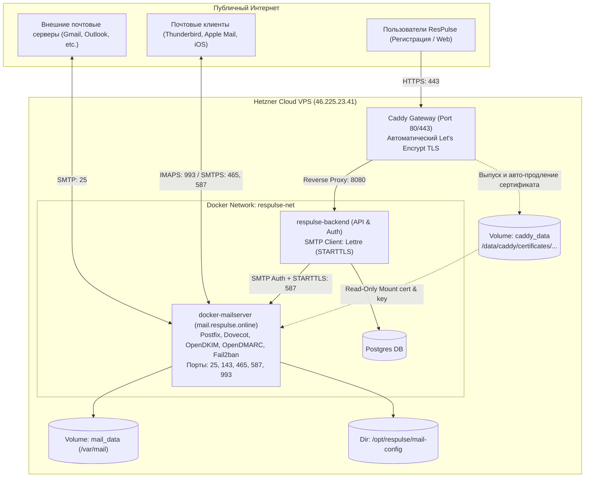

# ResPulse Production Mail Server Documentation

Документация по архитектуре, конфигурации, учетным данным и обслуживанию почтового сервера проекта **ResPulse** (`respulse.online`).

---

## 1. Архитектура и сетевая топология

Почтовый сервер развёрнут в контейнере Docker на базе официального образа **Docker Mailserver (v16)** на продакшн-сервере Hetzner (`46.225.23.41`).



---

## 2. Параметры контейнера и окружения

### Docker Compose (`/opt/respulse/docker-compose.yml`)

```yaml
  respulse-mailserver:
    image: mailserver/docker-mailserver:latest
    container_name: respulse-mailserver
    hostname: mail
    domainname: respulse.online
    restart: unless-stopped
    ports:
      - "25:25"       # SMTP (входящая почта и обмен с внешними серверами)
      - "143:143"     # IMAP (STARTTLS)
      - "465:465"     # SMTPS (Implicit TLS)
      - "587:587"     # Submission (STARTTLS для клиентов и бэкенда)
      - "993:993"     # IMAPS (Implicit TLS)
    volumes:
      - mail_data:/var/mail
      - mail_state:/var/mail-state
      - mail_logs:/var/log/mail
      - ./mail-config:/tmp/docker-mailserver
      - caddy_data:/etc/caddy-certs:ro
    environment:
      - OVERRIDE_HOSTNAME=mail.respulse.online
      - DMS_VML=0
      - ENABLE_RSPAMD=0
      - ENABLE_OPENDKIM=1
      - ENABLE_OPENDMARC=1
      - ENABLE_AMAVIS=0
      - ENABLE_SPAMASSASSIN=0
      - ENABLE_CLAMAV=0
      - ENABLE_FAIL2BAN=1
      - SSL_TYPE=manual
      - SSL_CERT_PATH=/etc/caddy-certs/caddy/certificates/acme-v02.api.letsencrypt.org-directory/mail.respulse.online/mail.respulse.online.crt
      - SSL_KEY_PATH=/etc/caddy-certs/caddy/certificates/acme-v02.api.letsencrypt.org-directory/mail.respulse.online/mail.respulse.online.key
      - POSTMASTER_ADDRESS=postmaster@respulse.online
      - ONE_DIR=1
      - PERMIT_DOCKER=network
      - SPOOF_PROTECTION=1
      - LOG_LEVEL=info
    cap_add:
      - NET_ADMIN
    networks:
      respulse-net:
        aliases:
          - mail.respulse.online
```

### Ресурсная оптимизация
* Отключение ClamAV и Amavis экономит более 1.5 ГБ оперативной памяти.
* Сервер стабильно потребляет **всего ~200–300 МБ ОЗУ**, обеспечивая работу Postfix, Dovecot, OpenDKIM, OpenDMARC и Fail2ban.

---

## 3. Учётные записи почты и реквизиты доступа

### Подключение через почтовые клиенты (Thunderbird, Apple Mail, Outlook, iOS, Android):

* **Сервер входящей почты (IMAP)**: `mail.respulse.online`
  * Порт: `993`
  * Безопасность соединения: `SSL/TLS`
  * Метод аутентификации: `Обычный пароль` (Normal Password / Plain)
* **Сервер исходящей почты (SMTP)**: `mail.respulse.online`
  * Порт: `587` (STARTTLS) или `465` (SSL/TLS)
  * Метод аутентификации: `Обычный пароль` (Normal Password / Plain)

### Созданные почтовые ящики

| Ящик | Логин | Пароль | Назначение |
| :--- | :--- | :--- | :--- |
| **`info@respulse.online`** | `info@respulse.online` | `cQwjcww4p1Q6cCkQNA0CHRHK` | Служебный ящик, отправка подтверждений регистрации и уведомлений системы |
| **`contact@respulse.online`** | `contact@respulse.online` | `TmCZZiIczPeXTHXqHIsCPk4v` | Ящик для обратной связи с клиентами и отчётов DMARC |

---

## 4. Конфигурация DNS (10/10 Deliverability)

Все записи настроены у регистратора (Openprovider) и в панели Hetzner Cloud:

| Имя / Subdomain | Тип | Значение / Адрес | Приоритет | Назначение |
| :--- | :---: | :--- | :---: | :--- |
| `mail` | **A** | `46.225.23.41` | — | IP-адрес почтового сервера |
| `@` (или пусто) | **MX** | `mail.respulse.online` | `10` | Маршрутизация входящих писем |
| `@` (или пусто) | **TXT** | `v=spf1 mx a:mail.respulse.online ip4:46.225.23.41 ~all` | — | **SPF**: авторизация сервера на отправку |
| `mail._domainkey` | **TXT** | `v=DKIM1; h=sha256; k=rsa; p=MIIBIjANBgkqhkiG9w0BAQEFAAOCAQ8AMIIBCgKCAQEAxRg1DGddDd4JSc+vKS5MeOtfyzVTLgK+Low+fgOkltsRD2c7QXkJbOS9G3XWtOinSFLn6VNxtw9xjaq1oBHOpMX8lIFR6PNM/ynXr9ib3i947UOFp8H7LzHKCpnTcdcZrbjl7DcutxdQarxDU3ETVY4qUC9IoOkovealq3U1utNXSjeZNzihywmjgrxeyjO3loS0huYrHyRHPfolYTWWG1PL7Tkvn/9Qyrp8bb84/NWxxu1WWoImTZcZvTKS2f5ZNX9inzQC+Tet9Yl/i3EshD7QBIazPn0v8u2LvQuoovbNR3S0GEQkDLTYPgF+5B04/urIMZ3aL6MIWzvygM6TbQIDAQAB` | — | **DKIM**: 2048-битный открытый ключ подписи писем |
| `_dmarc` | **TXT** | `v=DMARC1; p=quarantine; rua=mailto:contact@respulse.online; ruf=mailto:contact@respulse.online; sp=quarantine; fo=1` | — | **DMARC**: политика карантина при подделке отправителя |
| **Hetzner PTR** | **rDNS** | `mail.respulse.online.` | — | Обратное соответствие IP ➔ Domain для предотвращения спам-блокировок |

---

## 5. Интеграция с ResPulse Backend

В файле `/opt/respulse/.env` на продакшн-сервере заданы параметры:

```bash
SMTP_HOST=mail.respulse.online
SMTP_PORT=587
SMTP_TLS=starttls
SMTP_USERNAME=info@respulse.online
SMTP_PASSWORD=cQwjcww4p1Q6cCkQNA0CHRHK
SMTP_FROM=ResPulse <info@respulse.online>
REQUIRE_EMAIL_VERIFICATION=true
```

### Логика работы:
1. При самостоятельной регистрации пользователя через форму `/api/auth/register` создаётся аккаунт со статусом ожидания активации (`is_active = false`).
2. Генерируется криптографический одноразовый токен (TTL 24 часа).
3. ResPulse Backend подключается через `lettre` по внутреннему Docker-каналу к `mail.respulse.online:587` с использованием TLS.
4. Отправляется брендированное письмо со ссылкой `https://respulse.online/verify-email?token=...`.
5. Письмо подписывается OpenDKIM и отправляется получателю.
6. После перехода по ссылке статус пользователя обновляется на подтверждённый (`email_verified_at = NOW()`), и доступ к дашборду открывается.

---

## 6. Шпаргалка по администрированию и обслуживанию

Все команды управления выполняются на сервере (`ssh dev@respulse.online`):

### Управление ящиками
```bash
# Список всех ящиков:
docker exec respulse-mailserver setup email list

# Создать новый ящик:
docker exec respulse-mailserver setup email add newuser@respulse.online "VerySecurePassword123"

# Сменить пароль для ящика:
docker exec respulse-mailserver setup email update info@respulse.online "NewPassword456"

# Удалить ящик:
docker exec respulse-mailserver setup email del unwanted@respulse.online
```

### Управление алиасами (пересылкой)
```bash
# Добавить алиас (все письма на support@ отправлять на contact@):
docker exec respulse-mailserver setup alias add support@respulse.online contact@respulse.online

# Список всех алиасов:
docker exec respulse-mailserver setup alias list
```

### Просмотр логов и мониторинг
```bash
# Логи почтового сервера в реальном времени:
docker logs --tail 100 -f respulse-mailserver

# Проверка очереди исходящих сообщений (Postfix queue):
docker exec respulse-mailserver mailq
```

### Защита от брутфорса (Fail2ban)
```bash
# Проверить статус заблокированных IP:
docker exec respulse-mailserver setup fail2ban status

# Разблокировать IP (если ошибочно забанили):
docker exec respulse-mailserver setup fail2ban unban <IP_АДРЕС>
```

### Резервное копирование почты
Почтовые ящики хранятся в Docker volume `respulse_mail_data` (`/var/lib/docker/volumes/respulse_mail_data/_data`).
Конфигурация (DKIM ключи, пароли, алиасы) находится в директории:
`/opt/respulse/mail-config/`
Рекомендуется периодически включать директорию `/opt/respulse/mail-config` и volume `respulse_mail_data` в архив резервных копий.
